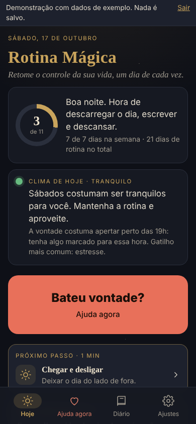
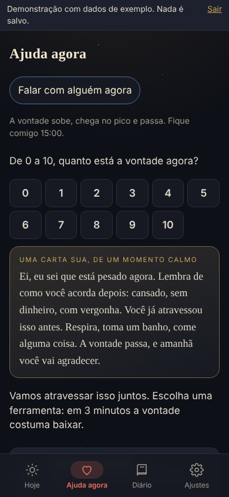
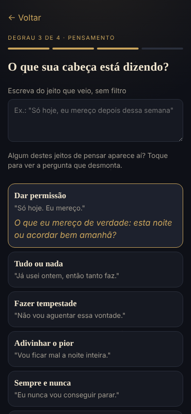
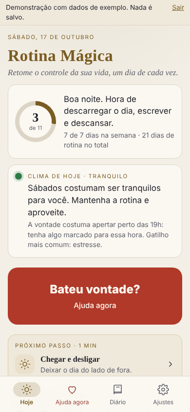

# Rotina Mágica

[](https://github.com/td9251156-creator/rotina-magica/actions/workflows/ci.yml)
[](LICENSE)
[](https://github.com/td9251156-creator/rotina-magica/labels/good%20first%20issue)

**Um app de código aberto, offline e privado, para quem quer parar de usar cocaína e retomar o controle da vida.**
Instala na tela inicial pelo navegador, funciona sem internet e **nenhum dado sai do celular**.

- **Abrir o app:** https://td9251156-creator.github.io/rotina-magica/
- **Ver com dados de exemplo (não toca em nada real):** https://td9251156-creator.github.io/rotina-magica/?demo

<p>
  
  
  
  
</p>

## Como usar

1. No celular, abra o link no Chrome (Android) ou no Safari (iPhone).
2. Instale: menu ⋮ → **Adicionar à tela inicial** (no iPhone: Compartilhar → **Adicionar à Tela de Início**).
3. Na hora da vontade, toque em **Ajuda agora**. No Android, segurar o ícone do app e tocar em **Agora** leva direto.

Não precisa de conta nem de internet depois de instalado. Para trocar de celular, use o backup com senha em Ajustes.

> Este app não substitui tratamento. Em crise: **CVV 188** (24 h, gratuito, também por chat), **SAMU 192**.
> O **CAPS AD** da sua cidade atende de graça pelo SUS, sem encaminhamento.

## Por que é diferente

| O que costuma acontecer | O que a Rotina Mágica faz |
|---|---|
| Contador de dias que **zera** na recaída e dá vergonha | O progresso **nunca zera**. Recaída vira informação, com 36 h de modo cuidado e um ajuste concreto |
| Conselho genérico, igual para todo mundo | **Clima de hoje**: uma previsão feita só com os seus dados ("sextas têm sido mais difíceis; a vontade aperta perto das 19h") |
| Na vontade, ninguém consegue ler texto | **Ajuda agora** abre em 2 toques, sem PIN, com práticas guiadas por tempo, jogos e a sua própria carta |
| O pensamento "só hoje, eu mereço" ganha a discussão | **Desatar um pensamento**: corpo, emoção, pensamento e resposta, com 11 armadilhas e a pergunta que desmonta cada uma |
| App de saúde que manda dados para a nuvem | Sem conta, sem servidor, sem analytics. PIN, backup cifrado e modo discreto |
| Espiritualidade ignorada (ou imposta) | Rotina **com ou sem ritual**, com os mesmos horários: você escolhe |

## O que tem dentro

- **Hoje** — a rotina em três tempos (Manhã: preparar, Tarde: proteger, Noite: cuidar), com o período da hora aberto,
  o próximo passo e um anel com o dia. Compromisso lido em voz alta toda manhã (editável).
- **Clima de hoje** — previsão de risco do dia da semana, hora de pico e gatilho mais comum, calculada no aparelho.
- **Ajuda agora** — carta do "eu calmo" para o "eu com vontade", cortar o pensamento, respiração em 4 tempos, foco no
  triângulo, 3 minutos de Blocos, nota da vontade antes e depois, e contatos de ajuda.
- **Práticas guiadas** — com tempo, vibração e uma imagem que acompanha: respiração, relaxamento muscular
  progressivo, visualização da luz pelo corpo.
- **Diário** — vontade de 0 a 10, gatilhos, quebras de padrão, "como a mente tentou te enganar" e "como você venceu",
  com 14 dias em barras e as suas armadilhas mais comuns.
- **Jogos, treinos de mente e laboratório** — jogos curtos com base em estudos, treinos que montam o seu kit de crise
  e um laboratório n-de-1 que mostra o que funciona com você.
- **Privacidade** — PIN (hash PBKDF2), backup com senha (AES-GCM), tema claro e noite, lembrete discreto pela agenda.

## A ciência por trás

- Prevenção de recaída, situações de alto risco e efeito de violação da abstinência: Marlatt e Gordon.
- Terapia cognitivo-comportamental e registro de pensamentos: Beck; distorções cognitivas: Burns.
- Observar a vontade como uma onda (urge surfing): Bowen e Marlatt.
- Respiração lenta e relaxamento muscular progressivo (Jacobson) para baixar a ativação.
- Tetris reduz a força da fissura: Skorka-Brown et al., 2014 e 2015.
- Intenções de implementação ("se… então…"): Gollwitzer. Pensamento de futuro episódico. HALT (fome, raiva, solidão, cansaço).
- Detalhes, decisões e limites da evidência: [`docs/visao-produto.md`](docs/visao-produto.md).

## Privacidade, de verdade

Tudo fica no `localStorage` do aparelho. O site é estático (GitHub Pages), sem cookies de rastreio, sem analytics e
sem crash reporting. Com PIN ativo, "Ajuda agora" abre sem pedir o PIN, mas esconde tudo o que você escreveu.
Mais em [`SECURITY.md`](SECURITY.md).

## Quero ajudar

- **Programo**: comece por uma issue [good first issue](https://github.com/td9251156-creator/rotina-magica/labels/good%20first%20issue). O passo a passo está em [CONTRIBUTING.md](CONTRIBUTING.md).
- **Trabalho com saúde mental ou dependência**: revise os textos e as técnicas ([issue #9](https://github.com/td9251156-creator/rotina-magica/issues/9)).
- **Falo outro idioma**: ajude a traduzir ([README em inglês, #5](https://github.com/td9251156-creator/rotina-magica/issues/5) e [interface, #8](https://github.com/td9251156-creator/rotina-magica/issues/8)).
- **Uso o app**: conte o que ajudou e o que atrapalhou numa [issue de ideia](https://github.com/td9251156-creator/rotina-magica/issues/new/choose). Não coloque dados pessoais.
- Integrações com serviços externos seguem regras próprias: [`docs/integracoes.md`](docs/integracoes.md).

## Rodar o código

```bash
npm install
npm run dev     # http://localhost:5173
npm test        # Vitest + Testing Library
npm run build
```

Vite + React + TypeScript, sem dependências de execução além do React. Regras de negócio puras e testadas em
`src/domain/`. Leia o [guia de contribuição](CONTRIBUTING.md) e o [código de conduta](CODE_OF_CONDUCT.md).
Ideias e problemas: abra uma issue. Andamento: [`ROADMAP.md`](ROADMAP.md). Guia técnico completo: [`CLAUDE.md`](CLAUDE.md).

## Apoie

O Rotina Mágica é e vai continuar de graça, sem anúncios e sem coletar dados. Se ele ajudou você ou alguém
próximo e você pode, [apoie o projeto pelo GitHub Sponsors](https://github.com/sponsors/td9251156-creator).
Como o dinheiro é usado e o que nunca vai mudar: [`docs/apoio-financeiro.md`](docs/apoio-financeiro.md).

Licença [MIT](LICENSE).

---

**English summary.** Rotina Mágica ("Magic Routine") is an open-source, offline-first, privacy-first PWA for people who
want to quit cocaine. It turns recovery into a daily routine (morning, afternoon, night; with or without ritual
practice), forecasts the day's risk from the user's own on-device data, guides timed practices (paced breathing,
progressive muscle relaxation, imagery), offers a CBT thought record with 11 thinking traps, and opens crisis help in
two taps without a PIN, starting with a letter the user wrote to themselves in a calm moment. Progress never resets.
No accounts, no servers, no analytics. Try it with sample data: add `?demo` to the URL.

**Contributing:** issues and pull requests in English are welcome. Good starting points: [good first issues](https://github.com/td9251156-creator/rotina-magica/labels/good%20first%20issue).
